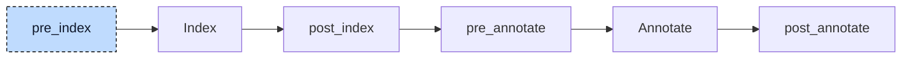

# Loop Desugar

Structured Text has three loops: `WHILE`, `REPEAT`, and `FOR`. They differ in when they test the condition and how they update the counter. Codegen uses one form, `WHILE TRUE`, with explicit `EXIT` statements. In

```iecst
FOR i := 10 TO 1 BY -3 DO
    sum := sum + i;
END_FOR
```

the counter starts at `10` and decreases by `3` each iteration. The loop ends when `i` is below `1`. The loop desugarer makes these steps explicit inside a `WHILE TRUE` body.



The participant runs once at `pre_index`. It needs only the parsed tree, so no index or annotations need to be rebuilt.

It makes three passes over every unit, one per loop kind, in the order `WHILE`, `REPEAT`, `FOR`. Each pass visits the body of a loop before the loop itself, so nested loops are rewritten from the inside out.


## Transformation

### `WHILE`

`WHILE` checks its condition before every iteration. The condition moves into the body as a guard that leaves the loop when it is false:

```diff
-WHILE count < limit DO
+WHILE TRUE DO
+    IF NOT count < limit THEN
+        EXIT;
+    END_IF
     count := count + 1;
 END_WHILE
```

### `REPEAT`

`REPEAT` checks its condition after the body. Placing the check at the end of the generated body would let `CONTINUE` skip it. Instead, the lowerer puts the check at the start and skips it on the first iteration:

```diff
+alloca __ran_once_0: BOOL;
-REPEAT
+WHILE TRUE DO
+    IF __ran_once_0 THEN
+        IF n >= 4 THEN
+            EXIT;
+        END_IF
+    END_IF
+    __ran_once_0 := TRUE;
     n := n + 1;
-UNTIL n >= 4
-END_REPEAT
+END_WHILE
```

### `FOR`

`FOR` uses three flags. `__ran_once_N` skips the counter update on the first iteration. Later iterations update the counter at the start, so `CONTINUE` cannot skip the update. `__is_incrementing_N` records the initial step direction and selects the exit comparison. `__past_end_N` keeps the result of that comparison across the counter update, until the exit test reads it:

```diff
+alloca __ran_once_0: BOOL;
+alloca __is_incrementing_0: BOOL;
+alloca __past_end_0: BOOL;
-FOR i := 10 TO 1 BY -3 DO
+i := 10;
+__is_incrementing_0 := -3 > 0;
+WHILE TRUE DO
+    IF __ran_once_0 THEN
+        IF __is_incrementing_0 THEN
+            __past_end_0 := i + -3 > 1;
+        ELSE
+            __past_end_0 := i + -3 < 1;
+        END_IF
+        i := i + -3;
+    ELSIF __is_incrementing_0 THEN
+        __past_end_0 := i > 1;
+    ELSE
+        __past_end_0 := i < 1;
+    END_IF
+    __ran_once_0 := TRUE;
+    IF __past_end_0 THEN
+        EXIT;
+    END_IF
     sum := sum + i;
-END_FOR
+END_WHILE
```

The first iteration compares the start value. Later iterations compare `i + -3` before the assignment stores it. The comparison uses the sum in the type that the resolver gives to the addition. This type has at least 32 bits, unless the counter and the step are both bit strings; then it is the wider of the two, so `BYTE` plus `BYTE#3` is a `BYTE`. The assignment then truncates the sum to the width of the counter. A counter narrower than 32 bits therefore ends the loop when its next value leaves its type: with `u : USINT`, `FOR u := 10 TO 1 BY -3` runs four times and leaves `u` at `254`. For a 32-bit or 64-bit counter, and for a bit-string counter with a bit-string step, the addition is usually only as wide as the counter. If the sum does not fit the type of the addition, it wraps before the comparison, and the loop can go on without end: with `d : DINT`, `FOR d := 2147483640 TO 2147483647 BY 5` does not end, and with `b : BYTE`, `FOR b := 250 TO 255 BY BYTE#3` does not end either. A wider step, such as a `LINT` step for a `DINT` counter, makes the addition wide enough. The counter is assigned on the last iteration too, so it keeps the value that ended the loop.

Without `BY`, the step is the literal `1` and the direction flag is set to `TRUE` directly. The step and the end value stay expressions in the tree, so a variable step or end is read again on every iteration, as in the source. From the second iteration on, the end value is read before the counter update, so an end expression that reads the counter sees the value of the pass that just ended. The step is read twice on each iteration after the first, once for the comparison and once for the update; only a step with side effects shows this. A step of `0` counts as not incrementing: the loop exits as soon as the counter is below the end value, so `FOR i := 1 TO 3 BY 0` runs zero times instead of forever. An `EXIT` or `CONTINUE` written by the user stays where it was and now refers to the generated `WHILE`.

The `alloca` lines are allocation statements, a node kind that has no spelling in Structured Text. They declare a variable in the middle of a body instead of in a `VAR` block. The resolver treats one like a local variable of the POU, named `main.__ran_once_0`, and codegen gives it a stack slot at the start of the function that starts at `FALSE` and lives for the whole call. The numbering is one counter shared by all `REPEAT` and `FOR` loops of the run, so every temporary has a unique name.

The counter, the step and the end value appear more than once in the generated tree. Every copy gets fresh node ids. The resolver annotates nodes by id, so each use gets its own type: the counter in `i + -3` does not take the type that the comparison with the end value gives to the counter.

Most generated nodes have internal source locations. Reused source nodes keep theirs: conditions still point to the original conditions, and counter setup, counter update and the first-iteration comparisons point to the `FOR` header. The assignments to `__past_end_N` also point to the header, because codegen takes the location of an assignment from its left side. A debugger can therefore stop on the source loop lines while skipping the other generated flags and loop-back jumps. The sum `i + -3` and its comparison stay internal, and the validator checks operand conversions only for an expression with a source location. The loop therefore reports the conversion warnings of the first-iteration comparison, the same warnings as `i > 1` in user code, and none for the generated sum.


## Interactions

Codegen accepts only `WHILE` loops with the literal condition `TRUE`. A `FOR` or `REPEAT` reaching it indicates a pipeline error. The [init participant](06-init.md) runs later and generates this final loop form directly. The [control statement participant](04-control-statements.md) also sees the rewritten loops. It splits the `ELSIF` of the `FOR` bound check into a nested `IF` in the `ELSE`, so codegen sees that form and not the one shown above.
