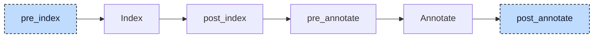

# Loop Desugar

Structured Text has three loops: `WHILE`, `REPEAT`, and `FOR`. They differ in when they test the condition and how they update the counter. Codegen uses one form, `WHILE TRUE`, with explicit `EXIT` statements. In

```iecst
FOR i := 10 TO 1 BY -3 DO
    sum := sum + i;
END_FOR
```

the counter starts at `10` and decreases by `3` each iteration. The loop ends when `i` is below `1`. The loop desugarer makes these steps explicit inside a `WHILE TRUE` body.



The participant rewrites the loops at `pre_index`. It needs only the parsed tree, so no index needs to be rebuilt. The second marked hook, `post_annotate`, belongs to a companion participant, the next-value typer, which is registered after the [property participant](02-property.md). It sets the type of one temporary per `FOR` loop from the annotated counter (see [`FOR`](#for)).

It makes three passes over every unit, one per loop kind, in the order `WHILE`, `REPEAT`, `FOR`. Each pass visits the body of a loop before the loop itself, so nested loops are rewritten from the inside out.


## Transformation

### `WHILE`

`WHILE` checks its condition before every iteration. The condition moves into the body as a guard that leaves the loop when it is false:

```diff
-WHILE count < limit DO
+WHILE TRUE DO
+    IF NOT count < limit THEN
+        EXIT;
+    END_IF
     count := count + 1;
 END_WHILE
```

### `REPEAT`

`REPEAT` checks its condition after the body. Placing the check at the end of the generated body would let `CONTINUE` skip it. Instead, the lowerer puts the check at the start and skips it on the first iteration:

```diff
+alloca __ran_once_0: BOOL;
-REPEAT
+WHILE TRUE DO
+    IF __ran_once_0 THEN
+        IF n >= 4 THEN
+            EXIT;
+        END_IF
+    END_IF
+    __ran_once_0 := TRUE;
     n := n + 1;
-UNTIL n >= 4
-END_REPEAT
+END_WHILE
```

### `FOR`

`FOR` uses two flags and one value. `__ran_once_N` skips the counter update on the first iteration. Later iterations update the counter at the start, so `CONTINUE` cannot skip the update. `__is_incrementing_N` records the initial step direction and selects the exit comparison. `__next_N` holds the next counter value, which the exit comparison reads:

```diff
+alloca __ran_once_0: BOOL;
+alloca __is_incrementing_0: BOOL;
+alloca __next_0: LINT;
-FOR i := 10 TO 1 BY -3 DO
+i := 10;
+__is_incrementing_0 := -3 > 0;
+WHILE TRUE DO
+    __next_0 := i;
+    IF __ran_once_0 THEN
+        __next_0 := __next_0 + -3;
+        i := __next_0;
+    END_IF
+    __ran_once_0 := TRUE;
+    IF __is_incrementing_0 THEN
+        IF __next_0 > 1 THEN
+            EXIT;
+        END_IF
+    ELSE
+        IF __next_0 < 1 THEN
+            EXIT;
+        END_IF
+    END_IF
     sum := sum + i;
-END_FOR
+END_WHILE
```

The step is read once per iteration, so the comparison and the counter see the same next value, also for a step with side effects. The assignment to the counter truncates the next value to the width of the counter, but the comparison reads `__next_0`, so it sees the exact value. The comparison does not read the counter back after the assignment. For a property counter whose getter does not return the value that its setter received, the loop compares the value it wrote, and the body can see a counter value past the end value. The counter is assigned on the last iteration too, so it keeps the value that ended the loop.

The desugarer does not know the type of the counter at `pre_index`, so it declares `__next_N` as `LINT`. It records the node ids of every copy `__next_N := i` and of its allocation, and shares them with the next-value typer. At `post_annotate` the typer reads the annotated type of the counter in each recorded copy. It runs after the property participant, because a property reference has no type annotation: the property participant replaces the counter in the copy with a getter call and keeps the node id of the copy, and the call has the type of the property. A signed or unsigned integer or a bit string of up to 32 bits, including `BOOL` and subranges and enumerations of these types, keeps `LINT`. Every other counter gives `__next_N` its own type, the intrinsic type behind an alias, a subrange or an enumeration: a 64-bit counter gives `LINT`, `ULINT` or `LWORD`, and `TIME`, `DATE` and `REAL` counters give their own type, because a `LINT` does not keep the meaning of these values. If a type changes, the typer annotates the project again, so that the uses of `__next_N` get the new type.

The sum of a `LINT` and an integer step of up to 32 bits is exact, so such a counter with such a step ends the loop when its next value leaves its type: with `u : USINT`, `FOR u := 10 TO 1 BY -3` runs four times and leaves `u` at `254`. An unsigned counter with a signed step compares without a change of sign: with `u : UDINT`, `FOR u := 2400000000 TO 2000000000 BY -100000000` runs five times. A 64-bit counter computes its next value in its own type, as an assignment to the counter does. A next value past the limit of the type wraps before the comparison, and the loop can go on without end: with `ul : ULINT`, `FOR ul := 10 TO 0 BY -1` does not end.

Without `BY`, the step is the literal `1` and the direction flag is set to `TRUE` directly. The step and the end value stay expressions in the tree, so a variable step or end is read again on every iteration, as in the source. The step is also read once before the loop, for the direction flag. A step of `0` counts as not incrementing: the loop exits as soon as the counter is below the end value, so `FOR i := 1 TO 3 BY 0` runs zero times instead of forever. An `EXIT` or `CONTINUE` written by the user stays where it was and now refers to the generated `WHILE`.

The `alloca` lines are allocation statements, a node kind that has no spelling in Structured Text. They declare a variable in the middle of a body instead of in a `VAR` block. The resolver treats one like a local variable of the POU, named `main.__ran_once_0`, and codegen gives it a stack slot at the start of the function that starts at zero (`FALSE` for a flag) and lives for the whole call. The numbering is one counter shared by all `REPEAT` and `FOR` loops of the run, so every temporary has a unique name.

The counter, the step, the end value and `__next_N` appear more than once in the generated tree. Every copy gets fresh node ids. The resolver annotates nodes by id, so each use gets its own type.

Most generated nodes have internal source locations. Reused source nodes keep theirs: conditions still point to the original conditions, and counter setup and comparisons point to the `FOR` header. A debugger can therefore stop on the source loop lines while skipping generated flags and loop-back jumps. In the comparisons, `__next_N` takes the location of the counter, and the validator checks their operand conversions as for `__next_0 > 1` in user code. A counter of up to 32 bits with a `ULINT` or `LWORD` end value therefore warns that the end value is converted to `LINT`; an end value of 2^63 or more becomes negative there, and the loop ends before the first pass. With a `REAL` or `LREAL` end value, such a counter warns that `LINT` is converted to `LREAL`. The copy and the addition stay internal and report no conversion warnings.


## Interactions

Codegen accepts only `WHILE` loops with the literal condition `TRUE`. A `FOR` or `REPEAT` reaching it indicates a pipeline error. The [init participant](06-init.md) runs later and generates this final loop form directly. The [control statement participant](04-control-statements.md) also sees the rewritten loops. The next-value typer runs right after the property participant and before the [polymorphism participant](03-polymorphism.md), so all later lowerers see the final type of `__next_N`.
